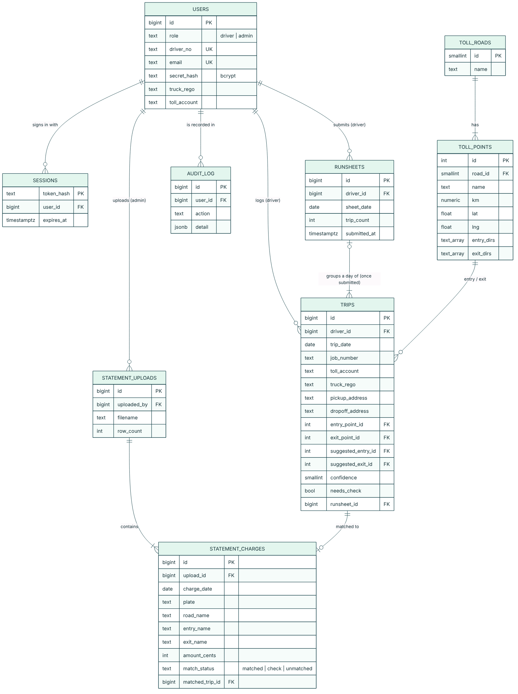

# TollTrack MVP

**Log every toll in seconds. Never lose a charge again.**

TollTrack replaces the paper toll runsheet used by small Melbourne transport companies. Drivers log each toll trip on their phone during the shift. The app suggests the official toll entry and exit points from the pickup and drop-off addresses. At the end of the day the runsheet goes to the office. The office uploads the Linkt toll statement, and TollTrack matches every charge to a logged job and shows tolls that can't be billed.

Built for La Trobe University Assessment 3 (MVP development, deployment and critical evaluation), extending the Assessment 1 Figma prototype.

## What it does

| User | Workflow |
|------|----------|
| Driver (phone) | Sign in with driver ID + PIN → **Today** → **Log a toll trip** (job, pickup, drop-off) → **Suggested toll route** with confidence and reason → confirm or edit → **Review today** (fix flagged trips) → **End work day** → runsheet sent (PDF/CSV) |
| Office admin (desktop) | Dashboard (runsheets, flagged trips, suggestion acceptance rate, money at risk) → view runsheets → **upload toll statement CSV** → automatic matching (matched / check / no trip) → billing CSV by job → manage drivers and PINs → activity log |

## Improvements since the Assessment 1 prototype

| Assessment 1 (Figma) | Assessment 3 MVP |
|---|---|
| Clickable screens with sample data | Working app with a PostgreSQL database; data entered on screen is stored and retrieved |
| Fake "AI" suggestion (fixed 92%) | Real suggestion engine: looks up addresses, checks every legal entry/exit pair on CityLink, EastLink and West Gate Tunnel, and explains its confidence and reasoning |
| "Runsheet sent" was a static screen | Runsheet generated from the saved trips, locked after sending, downloadable as PDF/CSV |
| Statement matching was a promise ("AI will match…") | Office portal uploads the statement and matches charges to jobs automatically |
| No sign-in logic | Hashed PINs/passwords, sessions, lockout after 5 failed attempts, driver vs office roles |
| — | Validation, audit log, security headers, unit and end-to-end tests |

## Tech stack

- **Next.js 14** (React, server components and server actions): front end and back end in one app
- **PostgreSQL** on **Supabase** (database), connected with the `postgres` driver using parameterised queries
- **Vercel** for hosting (Sydney region)
- **OpenStreetMap Nominatim** for address lookup (free), with an offline suburb fallback and a lookup cache
- **zod** for input validation, **bcryptjs** for PIN/password hashing
- **Vitest** unit tests and **Playwright** end-to-end tests

## Data model



- `users`: drivers and office admins in one table with a `role`. Drivers sign in with `driver_no`, admins with `email`. Only a bcrypt hash of the PIN/password is stored.
- `toll_roads` / `toll_points`: reference data for the toll network. Each point has a position along the road (`km`) and which directions you can enter or exit (`entry_dirs`, `exit_dirs`), so one-way ramps are respected.
- `trips`: the core record, one toll trip for one job. It stores what the driver chose (`entry_point_id`, `exit_point_id`) **and** what the engine suggested (`suggested_*`, `confidence`), so suggestion accuracy can be measured.
- `runsheets`: one per driver per day. When a day is submitted, its trips get a `runsheet_id` and become read-only.
- `statement_uploads` / `statement_charges`: each uploaded toll statement and its charge lines, with the match result (`matched`, `check`, `unmatched`) and the matched trip.
- `sessions`: signed-in sessions (only a SHA-256 hash of the cookie token is stored).
- `audit_log`: who did what and when (sign-ins, edits, submissions, uploads).
- `geocode_cache`: saved address lookups, to limit calls to the free map service.

## Demo accounts (made-up data)

| Role | Sign in | Secret |
|------|---------|--------|
| Driver | Driver ID `104` | PIN `2580` |
| Driver | Driver ID `117` | PIN `1357` |
| Office | `office@tolltrack.app` | `TollTrack-Demo-2026` |

## Run locally

```bash
npm install
cp .env.example .env.local       # set DATABASE_URL
npm run db:setup                 # creates tables + demo data
npm run dev                      # http://localhost:3000
npm test                         # unit tests
```

## Deploy

1. **Supabase**: create a project (region: Sydney). In the SQL Editor, run `db/schema.sql`, then `db/seed.sql`.
2. Copy the **Transaction pooler** connection string (port 6543) from Connect → Connection string.
3. **Vercel**: import this GitHub repo, add the environment variable `DATABASE_URL`, and deploy.

## Project structure

```
app/            pages (driver: /today, /trips, /review, /runsheets; office: /office/*) and API routes
app/actions/    server actions (sign-in, trips, office)
components/     UI components
lib/            suggestion engine, statement matching, auth, database, validation
db/             schema.sql, seed.sql, toll-points.json
tests/          unit tests (Vitest) and end-to-end test (Playwright)
VIBE_LOG.md     issues found in AI-generated code and how they were fixed
```

## Known limitations

- Toll point coordinates are approximate (about 300–800 m). Point names follow Linkt's published lists. Production would use official GIS data.
- The suggestion engine uses straight-line distances, not real road routing, so drivers confirm every suggestion.
- One toll road per trip. A job using two toll roads is logged as two trips.
- The statement CSV format is a simplified Linkt export. Real exports would need a mapping step.
- The rate limit is held in memory per server instance.
